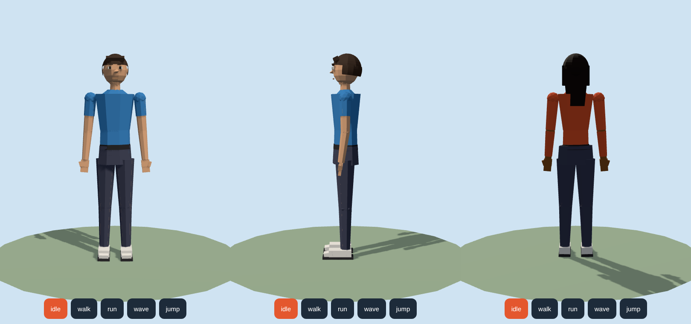
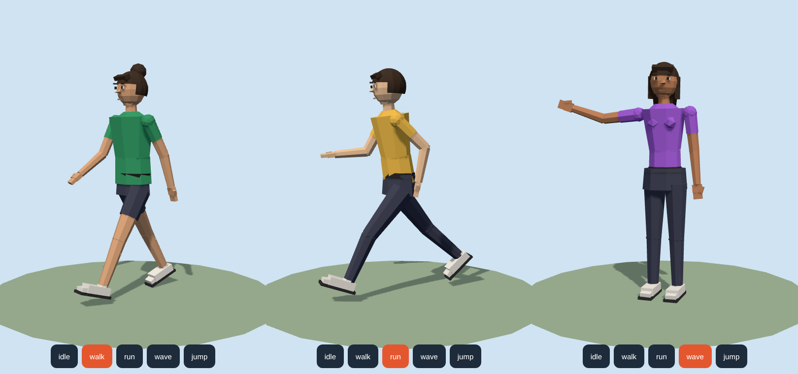

# Kiko — karakter low-poly humanoid (original, reusable)

Karakter manusia low-poly dengan proporsi realistis (~7,5 kepala), tampilan faceted,
±1.650 segitiga, dengan rangka sendi lengkap. Dibuat orisinal untuk dipakai berulang kali di game Astrocade (Three.js).




## File
| File | Fungsi |
|---|---|
| `lowpoly-human.js` | Modul Three.js: `createCharacter(THREE, opsi)` — karakter + animasi prosedural |
| `exports/kiko_*.glb` | Model siap pakai (3 varian) dengan klip `idle, walk, run, wave, jump` (±320 KB) |
| `preview.html` | Viewer interaktif (drag untuk memutar, tombol animasi). Query: `?hair=long&build=feminine&shirt=%23e4572e` |

## Pakai di game (modul JS)
```js
import * as THREE from 'three';
import { createCharacter } from './lowpoly-human.js';

const hero = createCharacter(THREE, { hair: 'long', build: 'feminine', shirt: '#e4572e', height: 1.75 });
scene.add(hero.root);        // menghadap +Z, kaki di y = 0
hero.play('walk');           // idle | walk | run | wave | jump
// game loop:
hero.update(Math.min(dt, 0.11));
hero.setColors({ shirt: '#00aa88', skin: '#8d5524' }); // ganti warna saat runtime
```
Opsi: `height, build (neutral|masculine|feminine), skin, hair (short|long|bun|bald), hairColor,
eyeColor, shirt, sleeves (short|long|none), pants, legs (long|shorts), shoes, belt`.
Sendi bisa digerakkan manual lewat `hero.joints.shoulderR.rotation.z = ...`.

## Pakai GLB di Astrocade
1. `begin_upload` (purpose `asset`, nama `kiko_neutral.glb`) → PUT file → `upload_asset`.
2. Masukkan entri `{url, type}` ke `asset_map.json`, lalu muat dengan `GLTFLoader` dan jalankan
   `AnimationMixer` (`gltf.animations` berisi 5 klip).
